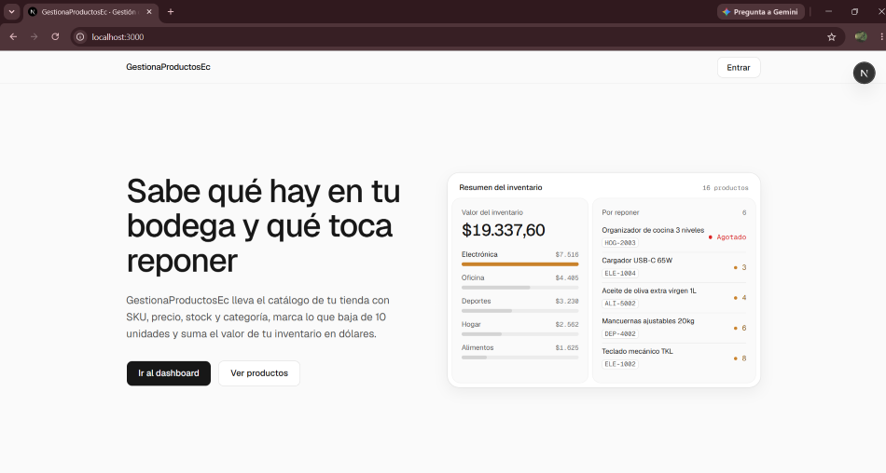
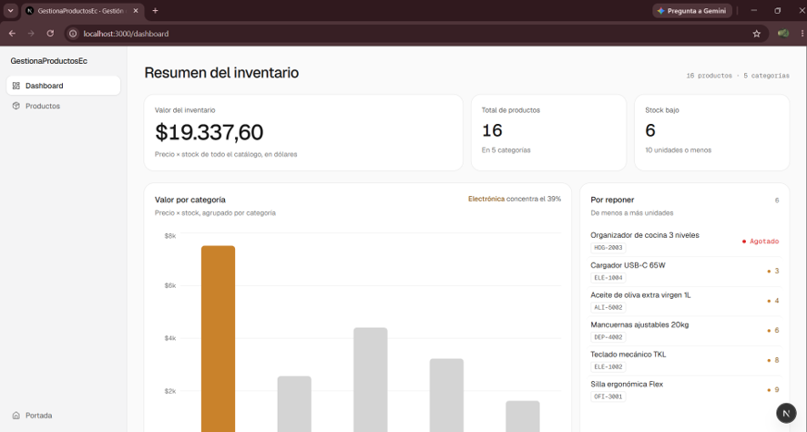
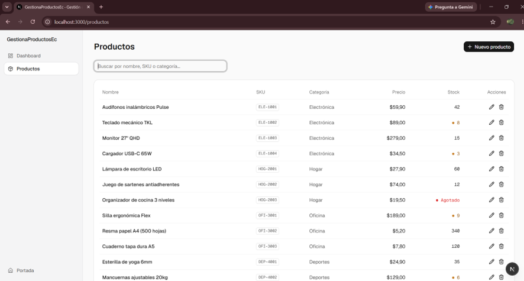
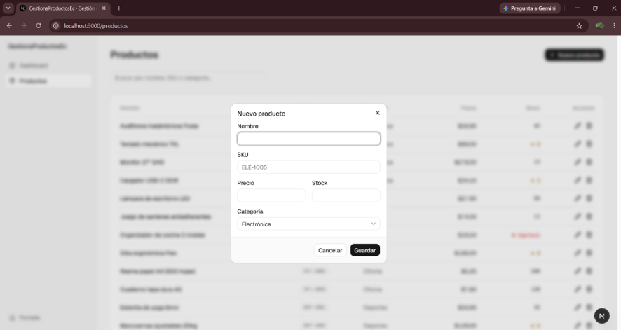
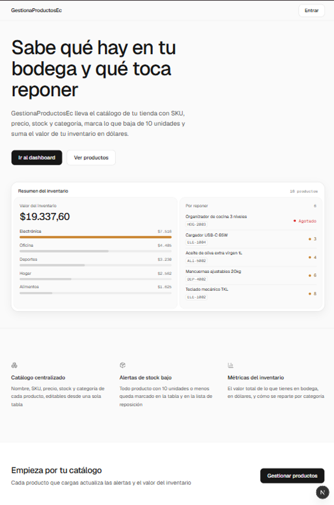
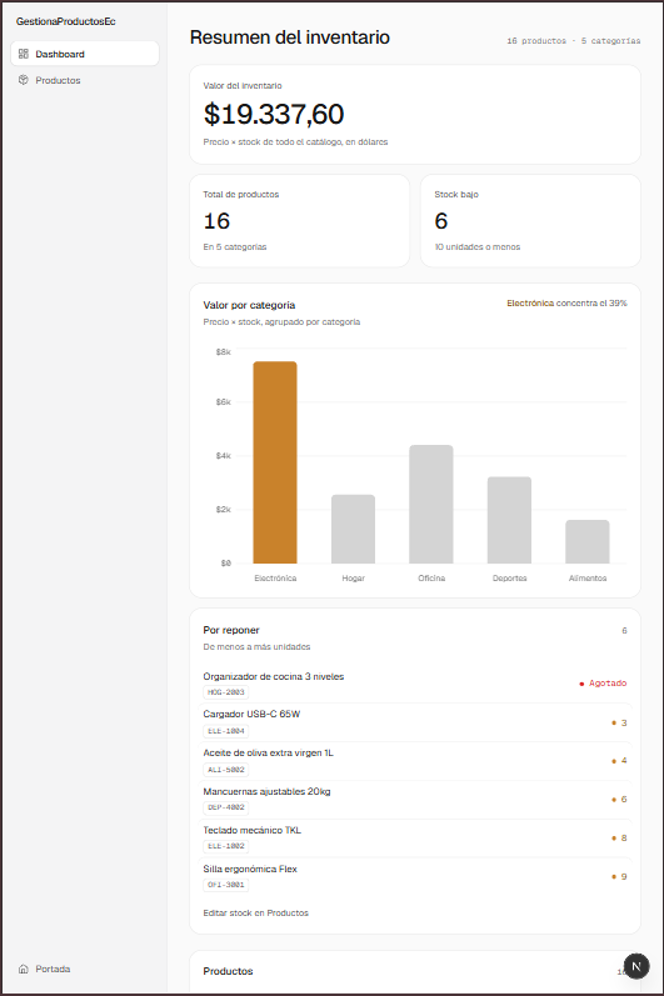
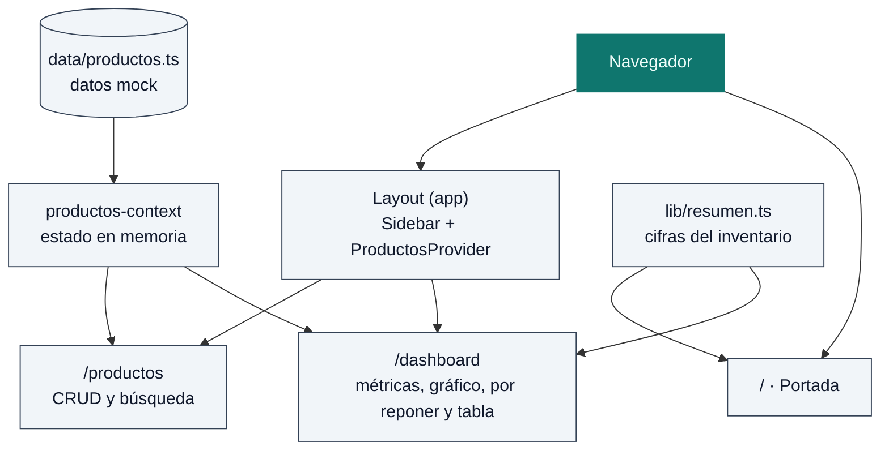

<div align="center" style="padding: 2% 0;">

# GestionaProductosEc

<p>
  
  
  
  
</p>

<p>
  
  
  
  
</p>

App web sencilla de gestión de productos: portada, dashboard con métricas e inventario, y CRUD de productos con nombre, SKU, precio, stock y categoría.

Es una **demostración**. Los datos son ficticios y viven en memoria.

</div>

---

## Descripción

Aplicación en **Next.js** (App Router) con **Tailwind CSS** y componentes **shadcn/ui**. No tiene backend ni base de datos: carga datos mock desde un archivo aparte y guarda los cambios en el estado de React mientras la pestaña está abierta.

- **Portada**: hero, tres funciones principales, llamada a la acción y footer.
- **Dashboard**: sidebar, métricas, gráfico de valor por categoría, lista de productos por reponer y tabla de productos.
- **Productos**: crear, editar, eliminar y buscar productos.

El diseño parte de shadcn/ui con un tema propio: superficies en grafito neutro, tipografía Geist y Geist Mono, y un único acento ámbar que marca la categoría de mayor valor y el stock bajo. El SKU se muestra como una etiqueta de estante en toda la app.

## Capturas

### Portada



### Dashboard



### Productos

| Lista y búsqueda | Crear o editar |
| --- | --- |
|  |  |

### Móvil

| Portada | Dashboard |
| --- | --- |
|  |  |

## Características

| Característica         | Descripción                                                                                         |
| ---------------------- | --------------------------------------------------------------------------------------------------- |
| **Portada**            | Hero con dos accesos y vista previa del inventario, tres funciones, sección CTA y footer.           |
| **Métricas**           | Total de productos, productos con stock bajo (≤ 10 unidades) y valor del inventario (precio × stock). |
| **Gráfico**            | Barras con el valor del inventario por categoría; la de mayor valor va resaltada con su porcentaje.  |
| **Por reponer**        | Lista de productos con stock bajo, ordenada de menos a más unidades.                                |
| **Tabla de productos** | Nombre, SKU, categoría, precio y stock; el stock bajo lleva un punto y lo agotado aparece en rojo.   |
| **CRUD**               | Formulario en diálogo para crear y editar, con validación. Eliminación con confirmación.            |
| **Búsqueda**           | Filtra por nombre, SKU o categoría.                                                                  |
| **Datos mock**         | 16 productos realistas en 5 categorías, en `src/data/productos.ts`.                                  |
| **Responsive**         | El sidebar pasa a barra superior en pantallas pequeñas.                                              |

## Arquitectura



| Módulo                              | Rol                                                                              |
| ----------------------------------- | -------------------------------------------------------------------------------- |
| `src/data/productos.ts`             | Tipo `Producto`, categorías, umbral de stock bajo, datos mock y formato de moneda. |
| `src/lib/productos-context.tsx`     | Estado compartido de productos: `crear`, `editar` y `eliminar`.                  |
| `src/lib/resumen.ts`                | Cifras derivadas del catálogo: valor total, valor por categoría y por reponer.   |
| `src/app/(app)/layout.tsx`          | Envuelve dashboard y productos con el sidebar y el proveedor de estado.          |
| `src/components/`                   | Sidebar, tabla, formulario, etiqueta de SKU e indicador de stock reutilizables.  |
| `src/components/ui/`                | Componentes de shadcn/ui generados por su CLI.                                   |

## Estructura del proyecto

```text
gestion-productos/
├── 📁 docs/
│   └── 📁 screenshots/                  # capturas del README
├── 📁 src/
│   ├── 📁 app/
│   │   ├── 📁 (app)/                    # rutas con sidebar
│   │   │   ├── 📁 dashboard/            # métricas, gráfico y tabla
│   │   │   ├── 📁 productos/            # CRUD de productos
│   │   │   └── 📄 layout.tsx            # sidebar + ProductosProvider
│   │   ├── 📄 layout.tsx                # layout raíz, fuentes y metadatos
│   │   ├── 📄 page.tsx                  # portada (landing) y vista previa
│   │   └── 📄 globals.css               # Tailwind y variables del tema
│   ├── 📁 components/
│   │   ├── 📁 ui/                       # componentes shadcn/ui
│   │   ├── 📄 sidebar.tsx
│   │   ├── 📄 tabla-productos.tsx
│   │   ├── 📄 formulario-producto.tsx
│   │   ├── 📄 etiqueta-sku.tsx          # SKU como etiqueta de estante
│   │   └── 📄 stock.tsx                 # cifra de stock con aviso de stock bajo
│   ├── 📁 data/
│   │   └── 📄 productos.ts              # datos mock
│   └── 📁 lib/
│       ├── 📄 productos-context.tsx     # estado en memoria
│       ├── 📄 resumen.ts                # cifras del inventario
│       └── 📄 utils.ts                  # helper cn()
├── 📄 components.json                   # configuración de shadcn/ui
├── 📄 package.json
└── 📄 README.md
```

## Stack tecnológico

| Categoría   | Tecnología                                                  |
| ----------- | ----------------------------------------------------------- |
| Runtime     | Node.js 22 LTS                                              |
| Lenguaje    | TypeScript 5.9 en modo estricto                             |
| Framework   | Next.js 16 (App Router), React 19                           |
| Estilos     | Tailwind CSS 4                                              |
| Componentes | shadcn/ui (estilo `base-nova`, sobre Base UI), lucide-react |
| Gráficos    | Recharts 3                                                  |
| Calidad     | ESLint 9 (configuración plana), `tsc` en el build           |

## Requisitos

- **Node.js 22 LTS** y **npm**.

No necesitas base de datos ni variables de entorno.

## Comandos

| Comando         | Descripción                                    |
| --------------- | ---------------------------------------------- |
| `npm install`   | Instala las dependencias.                      |
| `npm run dev`   | Servidor de desarrollo en `http://localhost:3000`. |
| `npm run build` | Compila para producción y revisa los tipos.    |
| `npm start`     | Sirve la versión compilada.                    |
| `npm run lint`  | ESLint en todo el proyecto.                    |

## Configuración y uso

```bash
npm install
npm run dev
```

Abre **http://localhost:3000**.

| Ruta         | Qué muestra                                         |
| ------------ | --------------------------------------------------- |
| `/`          | Portada.                                            |
| `/dashboard` | Métricas, gráfico por categoría, productos por reponer y tabla. |
| `/productos` | Lista con búsqueda, y botones para crear, editar y eliminar. |

### Cambiar los datos mock

Edita `src/data/productos.ts`:

- `productosIniciales`: la lista de productos.
- `CATEGORIAS`: las categorías disponibles en el formulario y el gráfico.
- `UMBRAL_STOCK_BAJO`: desde cuántas unidades un producto cuenta como stock bajo (por defecto 10).

### Añadir componentes de shadcn/ui

```bash
npx shadcn@latest add <componente>
```

Revisa que el componente nuevo importe `cn` desde `@/lib/utils`. La CLI generó `from "cn"` en la instalación inicial y hubo que corregirlo.

## Información general

- **Nombre del proyecto:** `gestion-productos`
- **Versión:** `0.1.0`
- **Idioma de la interfaz:** español
- **Moneda:** USD
- **Notas:**
  - Los cambios se pierden al recargar la página: no hay persistencia.
  - La eliminación usa el `confirm()` nativo del navegador.

---

<div align="center">

Proyecto de demostración · GestionaProductosEc

</div>
